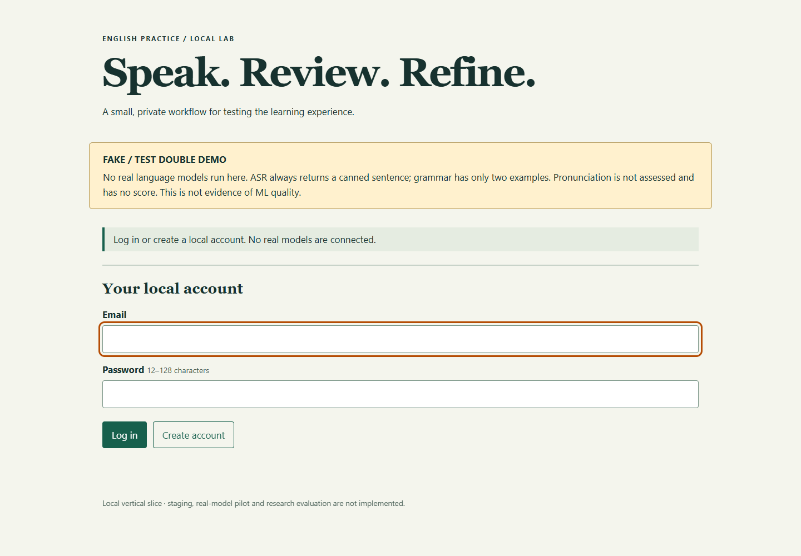
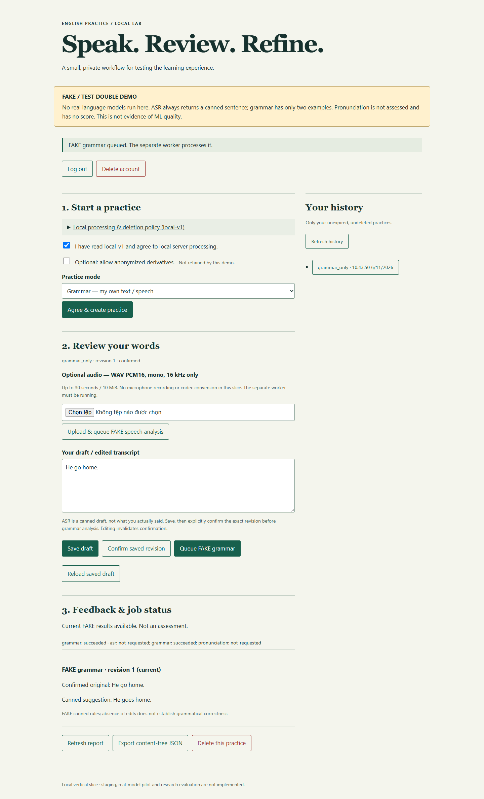
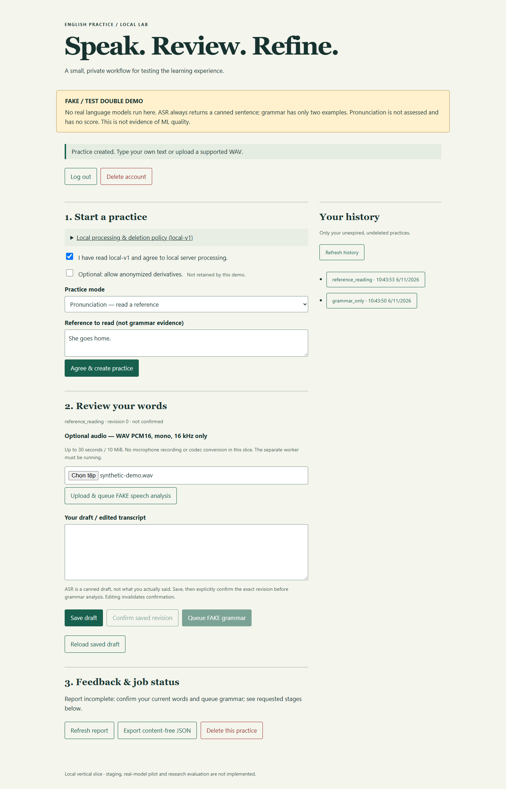
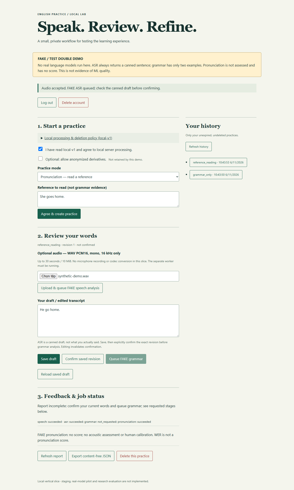
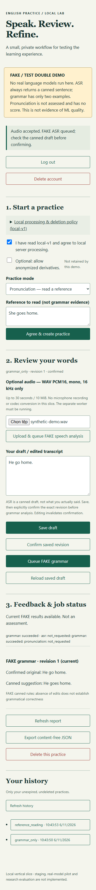

# English Speech & Grammar AI

Ứng dụng hỗ trợ luyện tiếng Anh, hướng tới đánh giá phát âm và sửa lỗi ngữ pháp bằng các mô hình học sâu. Dự án được phát triển trong khuôn khổ môn **Học máy nâng cao**.

> **Trạng thái hiện tại:** bản demo chạy local để kiểm chứng luồng ứng dụng. Mặc định (`ADAPTER_BACKEND=fake`) ASR, sửa ngữ pháp và đánh giá phát âm đều là **FAKE / TEST DOUBLE**. Tùy chọn `ADAPTER_BACKEND=real` chạy ASR và sửa ngữ pháp bằng mô hình pretrained (chưa đánh giá chất lượng); **phát âm vẫn là FAKE, không có điểm**. Kết quả không dùng để đánh giá năng lực tiếng Anh.

## Chức năng hiện có

- Đăng ký, đăng nhập, đăng xuất và xóa tài khoản; mật khẩu được băm bằng Argon2.
- Ghi nhận sự đồng ý trước khi tạo phiên luyện tập.
- Hỗ trợ nhập văn bản, nói tự do và đọc theo câu mẫu; luồng âm thanh dùng file WAV tải lên hoặc thu âm microphone trên trình duyệt (mã hóa WAV 16 kHz; cần `127.0.0.1`/`localhost` hoặc HTTPS).
- Lưu bản nháp và xác nhận phiên bản transcript trước khi gửi phân tích ngữ pháp.
- Xử lý job bất đồng bộ bằng worker riêng, hàng đợi PostgreSQL và cơ chế lease.
- Thử lại job `failed` bằng `POST /api/jobs/{jid}/retry` (tạo job mới, tối đa 3 lần/chuỗi).
- Rút consent bằng `POST /api/consents/{cid}/withdraw`: chặn job mới và xóa mọi phiên dùng consent đó.
- Xem lịch sử, báo cáo kết quả và xóa phiên luyện tập.
- Lưu âm thanh riêng tư và dọn dữ liệu hết hạn bằng scheduler.
- Giao diện web tĩnh đi kèm API; tài liệu OpenAPI tại `/docs` khi chạy ứng dụng.

### Phân biệt demo và mô hình thật

| Thành phần | Cách hoạt động hiện tại |
|---|---|
| ASR | Mặc định trả transcript mẫu cố định. Với `ADAPTER_BACKEND=real` dùng faster-whisper `base.en` (CPU, int8) nhận dạng âm thanh thật; chưa có số liệu WER |
| Ngữ pháp | Mặc định: hai cặp ví dụ định sẵn. Với `real`: `Unbabel/gec-t5_small` (T5-small, greedy, CPU); kết quả luôn qua kiểm tra span và chặn việc bỏ `not`/`never`/`no`; chưa có số liệu chất lượng |
| Phát âm | Luôn FAKE ở cả hai backend: không có điểm, không phân tích âm học |
| Tổng hợp phản hồi | Giữ riêng bằng chứng từng thành phần; job gắn nhãn FAKE nếu có stage FAKE được yêu cầu (job chỉ ngữ pháp ở backend `real` không gắn FAKE) |

## Ảnh giao diện và chức năng

Ảnh chụp trực tiếp từ ứng dụng local đang chạy, sử dụng tài khoản thử, văn bản ví dụ và WAV tổng hợp. Không có dữ liệu cá nhân thật. Nhãn **FAKE / TEST DOUBLE** được giữ nguyên: ảnh minh họa luồng phần mềm, không chứng minh chất lượng mô hình.



| Màn hình / chức năng | Ảnh thực tế |
|---|---|
| Đăng ký, đăng nhập | [01 — Tài khoản local](assets/screenshots/01-login.png) |
| Chính sách xử lý dữ liệu, consent và tạo phiên | [02 — Bắt đầu luyện tập](assets/screenshots/02-consent-and-practice.png) |
| Nhập văn bản, lưu nháp và xác nhận revision | [03 — Xác nhận transcript](assets/screenshots/03-confirm-transcript.png) |
| Worker hoàn tất job, phản hồi ngữ pháp giả lập | [04 — Kết quả ngữ pháp](assets/screenshots/04-grammar-feedback.png) |
| Đọc câu mẫu và chọn file WAV | [05 — Upload audio](assets/screenshots/05-reference-audio-upload.png) |
| Transcript ASR mẫu và phản hồi phát âm không có điểm | [06 — Kết quả speech giả lập](assets/screenshots/06-speech-feedback.png) |
| Chọn phiên cũ trong lịch sử và xem lại báo cáo | [07 — Lịch sử và báo cáo](assets/screenshots/07-history-and-report.png) |
| Bố cục màn hình hẹp 390 px | [08 — Giao diện mobile](assets/screenshots/08-mobile.png) |
| Xóa phiên và cập nhật lịch sử | [09 — Đã xóa phiên](assets/screenshots/09-practice-deleted.png) |
| Xóa tài khoản và trở về màn hình đăng nhập | [10 — Đã xóa tài khoản](assets/screenshots/10-account-deleted.png) |

<details>
<summary>Xem ảnh kết quả ngữ pháp và trạng thái job</summary>

Văn bản đã xác nhận `He go home.` được test double trả gợi ý định sẵn `He goes home.`; job hiển thị `succeeded`.



</details>

<details>
<summary>Xem ảnh upload WAV, ASR và phát âm giả lập</summary>

Phiên đọc mẫu sử dụng WAV tổng hợp. ASR trả câu cố định; phần phát âm ghi rõ không có điểm hoặc đánh giá âm học thực tế.





</details>

<details>
<summary>Xem giao diện mobile</summary>

Ảnh chụp viewport rộng 390 px; luồng thử không phát hiện tràn ngang.



</details>

Trong phiên chạy chụp ảnh đã kiểm tra đăng ký/đăng nhập, consent, lưu/xác nhận văn bản, job ngữ pháp, upload WAV, ASR/phát âm giả lập, lịch sử, tải JSON kỹ thuật không chứa nội dung văn bản, đăng xuất, xóa phiên và xóa tài khoản. Không ghi nhận lỗi JavaScript `pageerror`; tài khoản thử đã được xóa sau khi chụp. Scheduler cleanup không được chứng minh bằng các ảnh giao diện này.

## Công nghệ

- **Backend:** Python 3.12–3.13, FastAPI, Pydantic Settings, Uvicorn.
- **Dữ liệu:** PostgreSQL 17, SQLAlchemy 2, psycopg và Alembic.
- **Frontend:** HTML, CSS, JavaScript thuần.
- **Kiểm thử:** pytest, HTTPX, pytest-cov, Node.js test runner và Playwright.
- **Môi trường local:** Docker Compose cho PostgreSQL.

## Cấu trúc mã nguồn

```text
src/
  api/                 # API, xác thực, dữ liệu, lưu trữ và giao diện static
    static/            # HTML, CSS, JavaScript
  worker/              # Worker, cleanup, hợp đồng adapter và test doubles
migrations/            # Migration cơ sở dữ liệu
scripts/
  setup-local.ps1      # Tạo .env local với mật khẩu ngẫu nhiên
tests/                 # Integration, JavaScript regression và browser smoke tests
compose.yaml           # PostgreSQL local
alembic.ini            # Cấu hình Alembic
pyproject.toml         # Dependencies và cấu hình công cụ Python
.env.example           # Biến môi trường mẫu, không chứa secret thật
```

Tài liệu nội bộ, dữ liệu người dùng, trọng số mô hình và kết quả thực nghiệm không nằm trong nội dung công bố của repository.

## Cài đặt và chạy local

### 1. Chuẩn bị

- Python **3.12 hoặc 3.13**.
- Git và Docker Desktop với Linux engine đang chạy.
- Node.js để chạy test JavaScript; Microsoft Edge nếu chạy browser smoke test bên dưới.

Các lệnh dưới đây dành cho **Windows CMD**, chạy tại thư mục gốc dự án.

```cmd
git clone https://github.com/nguyenvudung365-commits/english-speech-grammar-ai.git
cd english-speech-grammar-ai
python -m venv .venv
.venv\Scripts\python.exe -m pip install -e ".[dev,browser]"
```

### 2. Tạo cấu hình riêng

```cmd
powershell -NoProfile -File scripts\setup-local.ps1
```

Script tạo `.env` với mật khẩu PostgreSQL ngẫu nhiên và **không ghi đè** file đã có. Tham khảo `.env.example` để xem các biến cấu hình; không dùng mật khẩu placeholder trong file mẫu.

| Biến | Ý nghĩa |
|---|---|
| `POSTGRES_PASSWORD` | Mật khẩu PostgreSQL local |
| `DATABASE_URL` | Chuỗi kết nối SQLAlchemy, phải khớp mật khẩu DB |
| `ORIGIN` | Origin giao diện, mặc định `http://127.0.0.1:8000` |
| `STORAGE_ROOT` | Thư mục audio riêng tư, mặc định `data/private-audio` |
| `COOKIE_SECURE` | `false` chỉ dành cho HTTP localhost |
| `QUEUE_GLOBAL` | Giới hạn hàng đợi toàn hệ thống, mặc định `32` |
| `QUEUE_PER_USER` | Giới hạn hàng đợi mỗi người dùng, mặc định `4` |
| `ADAPTER_BACKEND` | `fake` (mặc định) hoặc `real` (ASR + ngữ pháp thật; phát âm vẫn FAKE) |
| `ASR_MODEL`, `ASR_REVISION`, `GRAMMAR_MODEL`, `GRAMMAR_REVISION` | Thư mục model cục bộ và commit Hugging Face của từng model. Bắt buộc khác rỗng khi `real`, thiếu thì cấu hình báo lỗi ngay lúc khởi động |

Mô hình thật (tùy chọn, cần Internet một lần; thư mục `models/` nằm ngoài Git). Torch phải là bản CPU:

```powershell
.\.venv\Scripts\python -m pip install torch --index-url https://download.pytorch.org/whl/cpu
.\.venv\Scripts\python -m pip install -e ".[ml]"
.\.venv\Scripts\python -c "from faster_whisper import download_model; download_model('base.en', output_dir='models/asr/base.en')"
.\.venv\Scripts\python -c "from huggingface_hub import snapshot_download as d; d('Unbabel/gec-t5_small', revision='c958d53bfbce19c87342b69fc6bcaba7303d076f', local_dir='models/grammar/gec-t5_small', allow_patterns=['*.json','*.bin','spiece.model','README.md'])"
# trong .env: ADAPTER_BACKEND=real
#   ASR_MODEL=models/asr/base.en                  ASR_REVISION=3d3d5dee26484f91867d81cb899cfcf72b96be6c
#   GRAMMAR_MODEL=models/grammar/gec-t5_small     GRAMMAR_REVISION=c958d53bfbce19c87342b69fc6bcaba7303d076f
```

| Model | License (đọc trên model card) | Commit | Dung lượng |
|---|---|---|---|
| [`Systran/faster-whisper-base.en`](https://huggingface.co/Systran/faster-whisper-base.en) (ASR) | MIT | `3d3d5dee26484f91867d81cb899cfcf72b96be6c` | 141 MB trong `models/asr` |
| [`Unbabel/gec-t5_small`](https://huggingface.co/Unbabel/gec-t5_small) (ngữ pháp) | Apache-2.0 | `c958d53bfbce19c87342b69fc6bcaba7303d076f` | 233 MB trong `models/grammar` (checkpoint 242 MB) |

Model card `Unbabel/gec-t5_small` ghi huấn luyện trên clang-8, CoNLL-13/14; điều khoản của dữ liệu huấn luyện chưa được kiểm trong dự án này. Cài extra `ml` thêm khoảng 787 MB vào `.venv` (505 MB lên 1292 MB; torch 2.15.0+cpu, transformers 5.22.2, sentencepiece 0.2.3).

Model nạp một lần khi worker khởi động, chỉ từ thư mục cục bộ (`local_files_only`, không tải lúc chạy). `src/api` không import torch/transformers. Job xếp hàng trước khi đổi backend sẽ thất bại `CONFIG_MISMATCH`; bấm Retry để chạy lại với cấu hình hiện tại. Câu dài hơn 128 token thất bại `INPUT_TOO_LONG`; đầu ra sai hợp đồng hoặc bỏ phủ định thất bại `INVALID_ADAPTER_OUTPUT`. Một stage chạy quá 120 s sẽ mất lease (`WORKER_LOST`).

**Độ trễ đo thật** (máy dev Windows 11, CPU 12 luồng logic, không GPU, một tiến trình, file WAV 6,655 s): nạp toàn bộ (import + ASR + grammar) 10,65 s; ASR lần đầu (cold) 1,61 s, các lần sau (warm) 1,17-1,20 s; grammar lần đầu 0,37 s, các lần sau 0,14-0,33 s (câu ngắn, greedy). Đây là số đo một máy, một file, không phải benchmark chất lượng. Mẫu đầu ra grammar thật: `He go to school every day.` thành `He goes to school every day.`; `She don't like apples.` thành `She doesn't like apples.`; `I like to swimming` thành `I like swimming.`; câu đúng `She goes to school every day.` giữ nguyên.

Mật khẩu của volume PostgreSQL đã khởi tạo **không tự thay đổi** khi sửa `.env`. Không chia sẻ hoặc commit `.env`.

### 3. Khởi động cơ sở dữ liệu

```cmd
docker compose up -d --wait postgres
.venv\Scripts\python.exe -m alembic upgrade head
```

PostgreSQL chỉ được mở tại `127.0.0.1:55439`.

### 4. Chạy ba tiến trình

Mở ba cửa sổ CMD tại thư mục dự án.

**Cửa sổ 1 — API và giao diện:**

```cmd
.venv\Scripts\python.exe -m uvicorn src.api.main:app --host 127.0.0.1 --port 8000
```

**Cửa sổ 2 — worker xử lý giả lập:**

```cmd
.venv\Scripts\python.exe -m src.worker.runner
```

**Cửa sổ 3 — scheduler dọn dữ liệu:**

```cmd
.venv\Scripts\python.exe -m src.worker.runner --cleanup
```

- Giao diện: **http://127.0.0.1:8000**
- API docs: **http://127.0.0.1:8000/docs**
- Health check: **http://127.0.0.1:8000/healthz**

### 5. Thử luồng ứng dụng

1. Tạo tài khoản thử với mật khẩu 12–128 ký tự, sau đó đăng nhập. Không cần dùng email thật.
2. Chọn chế độ, đồng ý chính sách và tạo phiên luyện tập.
3. Với nhập chữ: nhập `He go home.` → **Save draft** → **Confirm saved revision** → **Queue FAKE grammar**.
4. Với âm thanh: tải file WAV hợp lệ; chế độ đọc mẫu cần thêm câu tham chiếu. Xác nhận transcript trước khi gửi phân tích ngữ pháp.
5. Xem phản hồi (có nhãn FAKE khi backend `fake`) và lịch sử; Retry job `failed`; có thể rút consent, xóa phiên hoặc tài khoản sau khi thử.

**Yêu cầu audio:** WAV PCM16, mono, 16 kHz, tối đa 30 giây và 10 MiB. Trình duyệt tự mã hóa WAV khi thu âm; bản demo không chuyển đổi MP3/WebM phía server. Worker phải chạy thì job mới được xử lý.

### Dừng ứng dụng

Nhấn `Ctrl+C` ở từng cửa sổ, sau đó:

```cmd
docker compose stop postgres
```

Volume DB được giữ lại. Không dùng `docker compose down -v` nếu không chủ động muốn xóa dữ liệu DB local.

## Kiểm thử

### Integration test với PostgreSQL thật

Chỉ dùng DB local dành cho kiểm thử, không trỏ đến production. Mỗi test tạo schema ngẫu nhiên rồi xóa chính schema đó; tài khoản DB cần quyền tạo schema.

Lệnh sau nạp URL từ cấu hình local mà không in mật khẩu:

```cmd
.venv\Scripts\python.exe -c "import os,pytest; from src.api.config import Settings; os.environ['TEST_DATABASE_URL']=Settings().database_url; raise SystemExit(pytest.main(['-q','--cov=src','--cov-report=term-missing']))"
```

Nếu chạy pytest mà không đặt `TEST_DATABASE_URL`, các test cần PostgreSQL sẽ **skip**, không có nghĩa là kiểm thử đã đạt.

### JavaScript và lint Python

```cmd
node --test tests/refresh-race.test.cjs
node --test tests/fake-label.test.cjs
node --test tests/ui-logic.test.cjs
.venv\Scripts\python.exe -m ruff check src tests migrations
```

### Browser smoke test

Cần Microsoft Edge đã cài, API và worker đang chạy:

```cmd
.venv\Scripts\python.exe tests\browser_smoke.py
```

Smoke test kiểm tra luồng nhập chữ, upload WAV, phản hồi giả lập, xóa tài khoản và giao diện desktop/mobile. Nếu test dừng giữa chừng có thể còn dữ liệu tài khoản thử. Đây không phải kiểm định chất lượng ML hoặc đánh giá accessibility đầy đủ.

## Quyền riêng tư và giới hạn

- Không đưa secret, audio cá nhân, dataset hoặc checkpoint vào Git.
- Audio không được phục vụ qua thư mục static; quyền truy cập gắn với tài khoản sở hữu.
- Scheduler xóa nội dung phiên và kết quả sau 24 giờ, kể cả phiên chỉ nhập chữ. Tùy chọn giữ dữ liệu dẫn xuất chưa được thực hiện vì chưa xác minh khả năng ẩn danh.
- Việc xóa tự động phụ thuộc scheduler đang chạy; khi máy tắt không thể bảo đảm xóa đúng thời điểm. Backup có vòng đời riêng do người vận hành quản lý.
- Cấu hình hiện tại **chỉ dành cho localhost**, chưa sẵn sàng mở ra Internet: chưa có HTTPS deployment, email verification, quên mật khẩu, backup và giám sát production.
- Rate limit chỉ có hiệu lực trong từng tiến trình. Job mất worker chuyển thành `WORKER_LOST`, người dùng có thể thử lại job `failed` (tối đa 3 lần/chuỗi, tạo job mới).
- Backend `real` đã tích hợp ASR và ngữ pháp pretrained nhưng **chưa có bộ dữ liệu đánh giá hoặc số liệu chất lượng** (WER, F0.5); đầu ra có thể sai, câu không có edit không chứng tỏ đúng ngữ pháp. Đánh giá phát âm chưa được làm (không có điểm).
- Thu âm microphone dùng `ScriptProcessorNode` (đã deprecated) và cần secure context. Ảnh chụp màn hình ở trên là của bản FAKE, chưa chụp lại với backend `real`.
